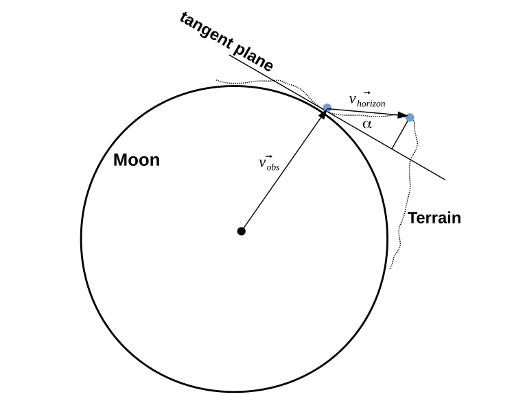
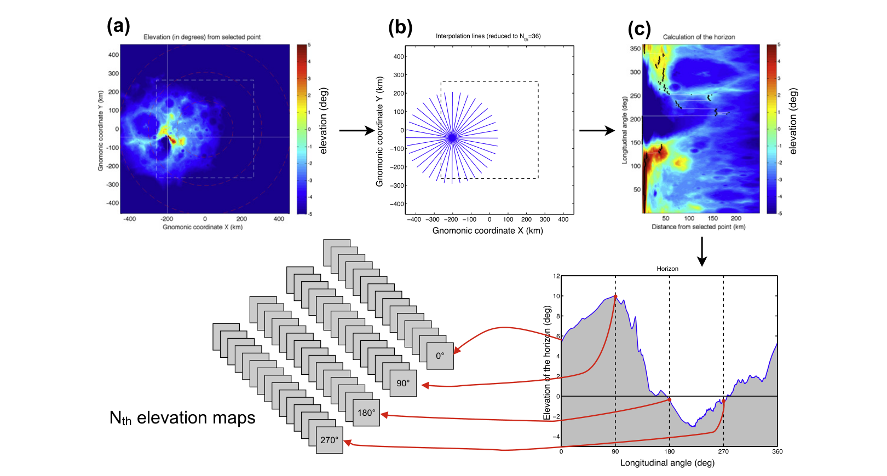
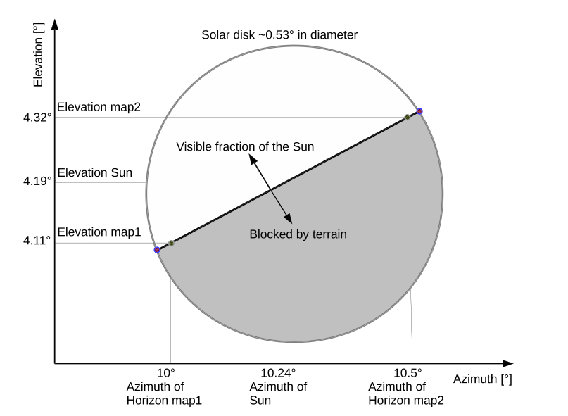
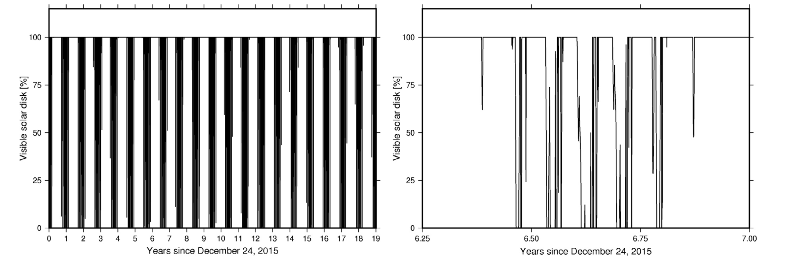
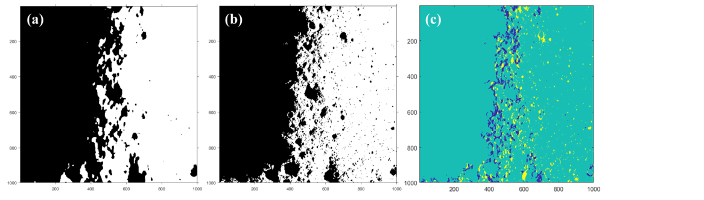
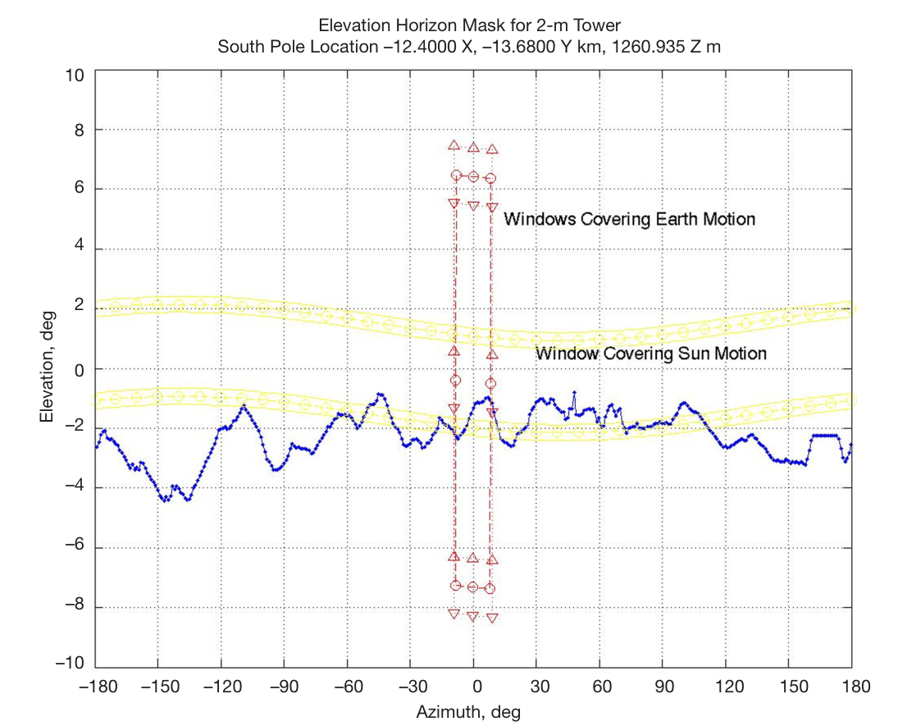
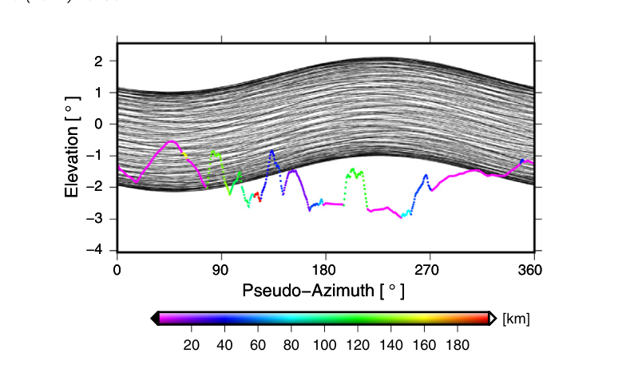
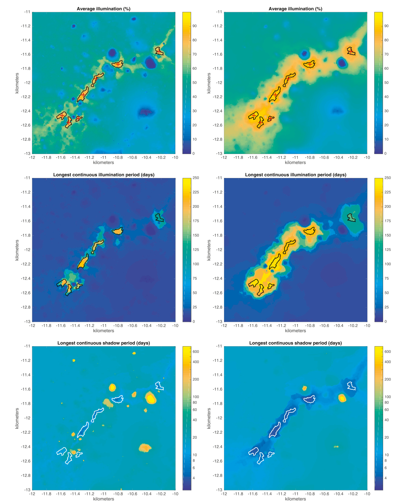
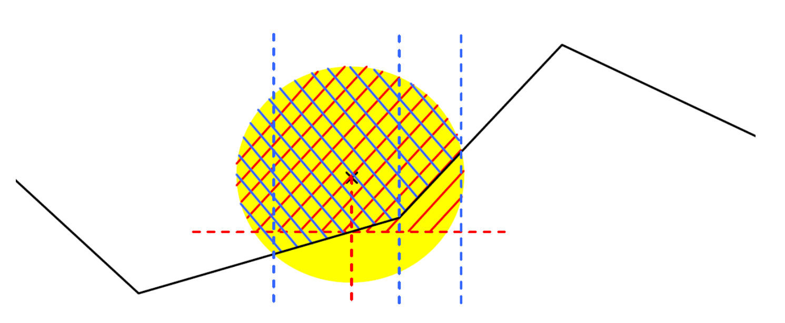
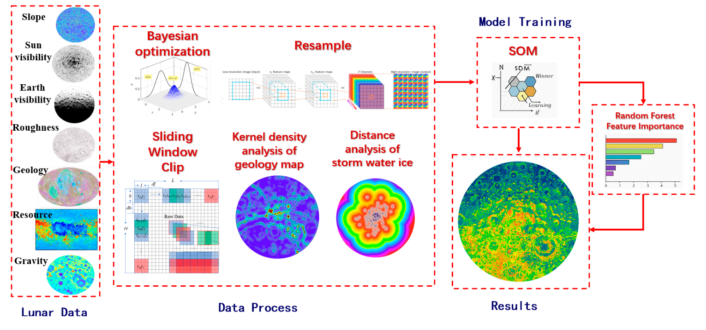

# Lunar Landing Site Navigator

Implementation specification for Antigravity. Prepared on 14 November 2026.

This document combines the application requirements, scientific equations, research review, source figures, and validation plan. Part A is the executable development brief in English. Parts B and C preserve the detailed Vietnamese scientific explanation and literature review. The equations are editable LaTeX, not OCR from images.

## How to use this document

1. Open the extracted package as a project folder in Antigravity.
2. Read this file in full, including the mathematical appendix.
3. Treat the source figures as methodological references, not as application data or new simulation results.
4. Implement the working application in the current workspace using Part A. Preserve the supplied reference assets under a documentation directory.
5. If original research PDFs have also been copied into the workspace, inspect the relevant sections before claiming to reproduce a paper. The package includes extracted figures and source metadata; it does not include the seven complete research PDFs.

## A. Development brief

### A.1 Agent execution directive

Act as a senior full-stack developer and aerospace scientific-computing engineer. Build a working application called **Lunar Landing Site Navigator** in the current workspace.

The application compares candidate lunar south-pole locations by visualizing the Sun and Earth relative to the local terrain horizon and calculating visibility windows during a specified mission period.

Deliver runnable software. Do not stop at a plan, static mockup, or explanation. Inspect the existing project and its instructions, make reasonable routine implementation decisions, implement incrementally, run the required checks, and fix problems before finishing. Preserve unrelated existing work.

Use the equations in Part B with the engineering clarifications in Part A. If a source or service is unavailable, complete an explicitly labeled fallback and report what remains unavailable. Do not invent data access, scientific validation, or results.

### A.2 Product goal and boundaries

The user must be able to answer:

1. Where are the Sun and Earth relative to the local horizon?
2. When is direct sunlight geometrically available?
3. When is the Earth center visible?
4. When do these conditions overlap?
5. How do these conditions compare between up to three sites?
6. How does observer height change the terrain horizon and resulting metrics?

Core scope: surface-observer geometry, terrain obstruction, time windows, comparison, and export.

Sun visibility is an input to power analysis. Earth-center visibility is an input to communication analysis. Do not label either as a complete power-system or radio-link assessment. The tool does not certify landing safety or compute descent trajectories.

Do not add user accounts, billing, a chatbot, or an opaque overall site score to the MVP. Add power, slope, uncertainty propagation, or multicriteria analysis only after the core analysis works.

### A.3 Required user workflow

1. Open an immediately usable dashboard with clearly labeled example locations.
2. Add, edit, remove, and select up to three sites.
3. Set UTC start time, duration, and sampling interval.
4. Choose the ephemeris source, horizon source, and solar visibility model.
5. Run the analysis with real progress and actionable errors.
6. Explore the results through a synchronized time slider and charts.
7. Compare individual metrics and data coverage.
8. Export the time series, event windows, settings, assumptions, and provenance.

Initial defaults:

| Setting | Default |
| --- | --- |
| Mission duration | 7 Earth days |
| Sampling interval | 30 minutes |
| Display and export time | UTC |
| Solar model | Point-object model, explicitly labeled |
| Horizon | Simplified zero-degree reference unless a matching profile is supplied |
| Sites | Up to three editable illustrative coordinates |

Illustrative coordinates may be `(-89.20, 0.00)`, `(-89.20, 90.00)`, and `(-89.50, 180.00)` in `(latitude, east-positive longitude)` degrees. Use generic names such as Site A/B/C. These are arbitrary example points, not approved landing sites or verified named features. Their terrain elevations must not be invented.

Include both mission boundaries in the sample grid. Seven days sampled every 30 minutes produces **337 timestamps and 336 intervals**, totaling 168 hours. If the duration is not divisible by the step, append the exact stop time and integrate the final shorter interval correctly.

### A.4 Technology and repository organization

Preferred stack:

- React, TypeScript, and Vite for the frontend.
- Tailwind CSS or an existing equivalent styling system.
- Plotly.js, ECharts, or a comparable interactive scientific chart library.
- A lightweight Node.js/TypeScript backend for Horizons access, request queuing, validation, and caching.
- Vitest or the existing project test runner for numerical and parsing checks.

Adapt the stack to an existing repository when appropriate. Verify current official documentation before integrating external services or choosing version-specific APIs. No paid service should be required for the core prototype.

Suggested source organization:

```text
apps/web/src/components/
apps/web/src/features/sites/
apps/web/src/features/mission/
apps/web/src/features/charts/
apps/api/src/routes/
apps/api/src/services/horizons/
apps/api/src/services/cache/
packages/science/src/coordinates.ts
packages/science/src/horizon.ts
packages/science/src/visibility.ts
packages/science/src/solar-disc.ts
packages/science/src/intervals.ts
packages/science/src/metrics.ts
packages/science/src/export.ts
packages/science/src/types.ts
tests/fixtures/
docs/references/
```

Use deterministic numerical functions separated from HTTP and UI code. Share domain types across frontend and backend. Include installation, development, test, and production-build commands in the README.

### A.5 Data sources and their roles

| Resource | Role | Integration rule |
| --- | --- | --- |
| [Challenge details](https://www.spaceappschallenge.org/2026/challenges/lunar-landing-site-navigator/?tab=details) | Product context | Read before claiming compliance with challenge requirements |
| [Challenge resources](https://www.spaceappschallenge.org/2026/challenges/lunar-landing-site-navigator/?tab=resources) | Official resource list | Report if unavailable |
| [JPL Horizons](https://ssd.jpl.nasa.gov/horizons/) | Astronomical positions | Prefer documented surface-observer outputs |
| [Horizons manual](https://ssd.jpl.nasa.gov/horizons/manual.html) | Frames, units, output definitions | Verify all observing-site conventions |
| [Horizons API](https://ssd-api.jpl.nasa.gov/doc/horizons.html) | Backend integration | Verify current parameters and usage guidance |
| [LROC QuickMap](https://quickmap.lroc.asu.edu/) | Imagery and terrain exploration | Do not assume every website tool exposes a public API |
| [NASA Moon Trek](https://trek.nasa.gov/moon/) | Terrain exploration and possible comparison | Verify access requirements and permalink formats |
| [PGDA topography products](https://pgda.gsfc.nasa.gov/products/78) | LOLA terrain and uncertainty products | Preserve product metadata, frame, coverage, and resolution |
| [PGDA polar illumination](https://pgda.gsfc.nasa.gov/products/69) | Published illumination/visibility products | Long-term averages do not replace a mission-specific time series |
| [CSA Moon exploration](https://www.asc-csa.gc.ca/eng/astronomy/moon-exploration/) | Educational context | Use for explanation, not ephemeris computation |

The research evidence is organized in Parts B-D. An eighth paper by Tong et al. was included in the earlier overview, but its full text was not among the seven supplied PDFs. Keep it as a bibliographic lead until its method is checked directly. Implementing finite-disc geometry does not require attributing an unverified equation to that paper.

### A.6 Coordinates, units, and reference surfaces

Required conventions:

- Latitude: north positive, degrees in UI and exports.
- Longitude: east positive; normalize consistently and document the accepted range.
- Azimuth: clockwise from local north, North 0°, East 90°, South 180°, West 270°.
- Elevation: angle above the plane perpendicular to the selected local zenith.
- Internal trigonometry: radians.
- Distances in scientific geometry: meters; explicitly convert API kilometers or astronomical units.
- Time: UTC for UI and export; keep any ephemeris time-scale conversion explicit.
- Store the DEM body-fixed frame, projection, reference radius/surface, horizontal datum, vertical datum, and no-data convention.

Distinguish three quantities:

1. DEM surface elevation relative to its reference surface.
2. Instrument height above local ground.
3. Total observer altitude required by the astronomical service.

Under compatible spherical reference definitions, total altitude is `terrainElevationM + observerHeightM`. If the reference surfaces or frames differ, convert them or expose the unresolved assumption. Do not send only a two-meter mast height when the site lies thousands of meters above the reference sphere.

The spherical equations in Part B use radius 1,737,400 m. A production implementation must follow the actual product metadata and service conventions rather than silently overriding them with this constant.

At the exact pole, choose and document a reference meridian for horizontal axes. At zenith/nadir, azimuth is undefined and must not be treated as a meaningful numeric direction.

If using state vectors, express the terrain, observer, and celestial direction in compatible lunar body-fixed/local frames. Do not mix inertial vectors with body-fixed DEM coordinates. Preserve the distinction between instantaneous geometric directions and light-time/aberration-corrected apparent directions.

### A.7 Horizons integration

Preferred path: request observer-table azimuth and elevation for each celestial target from the lunar observing site.

Previously checked identifiers and conventions, to verify against the current documentation before coding:

- Sun center: `10`.
- Earth center: `399`, not the Earth-Moon barycenter.
- Moon: `301`.
- User-defined observing site on the Moon: the documented `coord@301` surface-observer form.
- Observer quantity `4`: apparent azimuth/elevation.
- Airless outputs; do not apply terrestrial atmospheric refraction.
- Moon site longitude input: east positive.
- Lunar mean-Earth frame conventions must agree with the DEM or be explicitly transformed.
- Geodetic site altitude is relative to the service's reference surface, not automatically above ground.

Potential parameter families to verify: `COMMAND`, `EPHEM_TYPE`, `CENTER`, `COORD_TYPE`, `SITE_COORD`, `START_TIME`, `STOP_TIME`, `STEP_SIZE`, `TIME_TYPE`, `QUANTITIES`, `APPARENT`, `CSV_FORMAT`, and output precision settings. This is an implementation checklist, not a claim that a particular request has already been executed successfully.

Backend requirements:

1. Validate and bound all numerical inputs.
2. Queue requests in accordance with current official usage guidance; do not fan out uncontrolled parallel calls.
3. Configure timeouts and bounded retries for transient failures.
4. Parse documented output fields and preserve headers needed for provenance.
5. Treat missing values and parse errors as unknown, never as zero elevation.
6. Return errors with enough context for the user to retry or select an explicit fallback.
7. Cache by all relevant inputs: target, site, total altitude, frame/surface assumptions, time range, requested timestamps or step, time scale, output quantities, and correction settings.
8. Keep immutable provenance with cached results. Never reuse a dataset for different coordinates or dates.
9. Restrict outbound requests to the configured service; do not make an arbitrary user-supplied URL a backend fetch target.

Retain request parameters, retrieval time, service/header version information when available, units, coordinate definitions, and corrections in exports.

### A.8 Explicit scientific modes

Represent provenance along independent axes rather than a single ambiguous flag:

| Axis | Examples |
| --- | --- |
| Ephemeris origin | live Horizons / matching cached real data / synthetic demonstration |
| Horizon origin | zero-degree reference / user-supplied profile / verified DEM-derived profile / synthetic profile |
| Solar model | center point / uniform disc with local line approximation / sampled disc |
| Validation | unvalidated / software checks passed / independently compared |

Display readable badges such as:

- Real ephemeris + simplified reference horizon.
- Real ephemeris + user-supplied terrain horizon, unverified provenance.
- Real ephemeris + DEM-derived terrain horizon.
- Synthetic demonstration, unsuitable for scientific conclusions.

Start with a bundled real dataset only if its retrieval and exact settings can be established. Otherwise use explicitly synthetic data, with synthetic coordinates/time/settings recorded. Do not label arbitrary periodic curves as Horizons output.

A live request failure must not silently trigger synthetic results. Changing inputs invalidates old results until recomputation. Show stale results as stale if retained for comparison; never relabel them with new settings.

### A.9 Horizon-profile import

CSV schema:

```csv
azimuth_deg,horizon_elevation_deg
```

Associate the profile with metadata:

```json
{
  "siteId": "site-a",
  "latitudeDeg": -89.2,
  "longitudeEastDeg": 0.0,
  "observerHeightM": 2.0,
  "terrainElevationM": null,
  "bodyFixedFrame": "must be declared",
  "verticalDatum": "must be declared",
  "azimuthConvention": "north-clockwise",
  "sourceKind": "user-supplied-unverified",
  "sourceDescription": "describe the originating data or calculation",
  "searchRadiusM": null,
  "demResolutionM": null
}
```

The numbers above illustrate settings; they do not establish a real horizon profile.

Validate numeric ranges, finite values, column names, coordinate association, height, angular convention, duplicate azimuths, directional gaps, and circular closure. Normalize 360° to 0° and resolve duplicate endpoints only if their elevations agree within a documented tolerance. Reject conflicting duplicates.

Implement circular interpolation across 359°/0°/1°. Do not interpolate through unacceptably large directional gaps. Missing profile coverage yields an unknown horizon in that direction. If a coarse profile is accepted for exploration, show its angular resolution and limitations.

Changing the site's coordinates or observer height invalidates its associated profile unless its metadata is updated through a valid recalculation. A user upload is not automatically verified real topography.

### A.10 DEM-derived horizon calculation

Use the vector geometry and maximum-angle rule in Part B. Convert terrain samples to 3D lunar body-fixed coordinates, subtract the observer position, rotate into local ENU, and take the maximum elevation along each azimuth direction.

The terrain stage is expensive but independent of mission timestamps. Cache the horizon by site, observer height, DEM product and version/hash, reference definitions, interpolation, azimuth resolution, and search settings.

Requirements:

- Include lunar curvature exactly once. Full 3D geometry already contains it.
- Use the DEM projection's actual inverse transform. A straight line on an arbitrary polar projection is not automatically a constant-local-azimuth terrain search.
- Preserve negative terrain-horizon elevations. An elevated observer can see a horizon below the local horizontal plane.
- Do not treat no-data cells as zero elevation or as proof of a clear line of sight.
- Include nearby terrain, without a zero-distance singularity; define how the observer's own cell is handled.
- Search far enough to include distant blocking terrain; quantify convergence instead of assuming one radius always suffices.
- Do not assume a small high-resolution landing-site tile contains every relevant far-field obstacle.
- Consider nested DEM resolutions as illustrated by Barker: 5 m/pixel within 5 km, 80 m/pixel from 5-100 km, and 240 m/pixel beyond 100 km. These are research settings to evaluate, not universal accuracy guarantees.
- A starting grid of 720 directions at 0.5° is literature-based. Test finer directions for sharp obstacles and finite-disc visibility.

A useful analytical check for a smooth sphere at radial observer height `h > 0` is the horizon dip:

$$
H_{\mathrm{sphere}}=-\arccos\left(\frac{R_M}{R_M+h}\right).
$$

Use it only with matching smooth-sphere assumptions and sufficient numerical search coverage. The zero-degree reference mode is a separate simplification, not this physical elevated-sphere horizon.

If automated DEM ingestion is blocked, finish importable horizon profiles and the geometric-reference workflow. Clearly identify DEM computation as unavailable rather than generating synthetic terrain in a real-data mode.

### A.11 Visibility and finite-disc models

Point model:

$$
g_X(t)=e_X(t)-H(A_X(t)),\qquad \chi_X(t)=\mathbf 1[g_X(t)>0].
$$

At equality, the specified strict rule reports obstructed. Keep a numerical tolerance separate from a user-facing engineering clearance angle. Do not silently add a terrestrial sunrise correction.

Earth clearance is a separate output:

$$
\chi_{E,\beta}(t)=\mathbf 1[e_E(t)>H(A_E(t))+\beta].
$$

Finite solar disc:

- Use the formula for a uniform disc and local straight horizon in Part B.
- With a nearly horizontal horizon, use `D = solarElevation - horizonElevation` in consistent angular units.
- With a sloped horizon, use signed perpendicular angular distance in the local sky tangent plane, or evaluate a deterministic set of disc samples against the horizon function.
- In a small local tangent-plane approximation, horizontal sky distance is `cos(e_sun) * deltaAzimuth`, not simply `deltaAzimuth`. Unwrap azimuth around the Sun before constructing the line.
- For a linear horizon `y = m*x + b` in tangent-plane coordinates centered on the solar center, the signed center-to-line distance is `D = -b / sqrt(1 + m*m)`, positive on the visible side. Keep radians consistent.
- Clamp roundoff in inverse-trigonometric/square-root arguments without concealing invalid input.
- Record whether solar angular radius is obtained from the target distance or a clearly labeled nominal assumption.
- Do not claim to reproduce limb darkening; the baseline disc has uniform brightness.
- Label terrain-only direct visibility if solar eclipses are not modeled.

Expose and preserve the definition of “sunlit”: center visible, any portion of the disc visible, or a selected disc-fraction threshold. Never compare metrics produced by different definitions as though they were the same quantity.

### A.12 Time integration and event windows

Use actual timestamp differences. The mission stop timestamp is a boundary, not an additional full sample-duration contribution.

1. Build continuous clearance functions for each target on valid intervals.
2. Locate threshold crossings by linear interpolation or a more accurate bracketed root finder where data access permits.
3. Split each interval at relevant crossings.
4. Produce ordered, nonoverlapping visible/obstructed/unknown windows.
5. Compute both-visible windows by intersecting Sun-visible and Earth-visible windows.
6. Sum window durations for binary metrics. Integrate disc fraction separately, for example with the trapezoidal rule.

Do not estimate simultaneous visibility by multiplying separately averaged visibility fractions. Do not interpolate only the Boolean endpoint values when continuous clearance is available.

If clearance has the same sign at both endpoints, a short visibility event may still occur between them. Use adaptive refinement near the horizon or disclose the temporal resolution limitation. Decreasing the sampling step should be part of convergence assessment.

Missing intervals split events. Do not extend a visible or dark run across a data gap. Do not bridge large sampling gaps without an explicit interpolation policy. Report maximum-gap thresholds and valid interval coverage.

Report:

- Sun-visible hours and percentage over valid Sun coverage.
- Earth-visible hours and percentage over valid Earth coverage.
- Longest continuous Sun-obstructed period.
- Longest continuous Earth-obstructed period.
- Both-visible hours and, if shown, percentage over joint valid coverage.
- Mean visible solar-disc fraction, when available.
- Valid data coverage for Sun, Earth, and joint analysis.
- Whether a longest window touches a mission boundary or an unknown-data boundary.

If valid coverage is zero, return `null` metrics with an explanation. Percentages must not become `NaN`, `Infinity`, or falsely zero. A longest observed blackout clipped by a mission boundary is not necessarily the full physical blackout.

### A.13 Optional physical extensions

After the core workflow works:

**Power:** implement the transparent panel-area/efficiency/incidence model in Part B. Expose panel orientation, solar irradiance assumptions, units, and neglected losses. Panel normal and terrain normal are separate inputs. Integrating watts over seconds requires division by 3,600 for watt-hours.

**Slope:** derive gradients in local metric coordinates, record the fitting window or spatial scale, and display a slope layer. A universal safe-landing slope threshold must not be inferred from one paper. Mission requirements determine limits.

**Observer height:** recompute the horizon for each height. Compare only matching coordinates, time periods, and visibility definitions. Height changes are not implemented by adding an arbitrary constant to a final percentage.

**DEM uncertainty:** support a documented ensemble of terrain realizations, recomputing observer elevation and horizon consistently. Show median/quantiles only with their uncertainty model. Independent white noise per pixel is not automatically a reproduction of Barker's clone method.

**Multicriteria evaluation:** begin with sortable individual metrics. SOM/Random Forest from Liu is an optional later extension. A clustering model does not by itself establish a universal ranking or safe landing certification.

### A.14 Dashboard and visualization

Build a responsive scientific dashboard with a dark navy background, cyan navigation accents, amber Sun markers, blue Earth markers, accessible contrast, and readable labels. Keep decorative content secondary to the analysis.

Required components:

| Component | Required behavior |
| --- | --- |
| Header | Product name, data-origin badges, selected mission UTC timestamp |
| Site panel | Up to three sites; name, coordinates, terrain elevation/assumption, observer height; validation and source association |
| Mission panel | UTC start, duration, sample step, sample count, analysis action |
| Lunar site view | Lunar map when reliable; otherwise labeled south-polar coordinate diagram with projection assumptions |
| Horizon chart | 0-360° azimuth, elevation axis, reference zero line, terrain profile, selected-time Sun and Earth, obstruction status |
| Time controls | Slider, play/pause, playback speed; synchronized across components |
| Elevation series | Sun/Earth elevations and horizon elevations sampled along their instantaneous azimuths |
| Visibility timeline | Sun visible, Earth visible, both visible; unknown shown distinctly |
| Comparison table | Individual metrics, coverage, model/provenance; sortable without declaring a universal best site |
| Exports | CSV, JSON, event windows, settings, assumptions, source metadata |
| Explanation panel | Azimuth, elevation, horizon obstruction, partial solar visibility, and interpretation limits |

Do not use an Earth basemap for the Moon. External links to QuickMap and Moon Trek are sufficient if map integration is unavailable. Use coordinate-specific external links only after verifying the permalink format.

The horizon view must support zooming around low elevations. Handle wraparound without drawing artificial lines across the chart. A true angular solar disc may be distorted by unequal axis scales; either use the correct aspect ratio or label its displayed size as illustrative.

Use symbols/patterns as well as color. Preserve readable charts on mobile. Include loading, no-data, stale-results, partial-failure, and retry states. Put source figures in documentation or an attributed methods view; do not display their published percentages as the application's own computed results.

### A.15 Domain model and API contract

The following TypeScript sketch establishes semantic requirements; refine it as needed while preserving units and unknown states.

```ts
type Visibility = "visible" | "obstructed" | "unknown";
type SolarModel = "point" | "uniform-disc-local-line" | "sampled-disc";
type EphemerisKind = "live-horizons" | "cached-real" | "synthetic-demo";
type HorizonKind = "zero-reference" | "user-supplied" | "dem-derived" | "synthetic-demo";

interface Site {
  id: string;
  name: string;
  latitudeDeg: number;
  longitudeEastDeg: number;
  observerHeightM: number;
  terrainElevationM: number | null;
  bodyFixedFrame: string;
  verticalDatum: string;
  horizonProfileId: string | null;
}

interface Mission {
  startUtc: string;
  stopUtc: string;
  samplingIntervalSeconds: number;
  timeScale: "UTC";
}

interface Provenance {
  id: string;
  sourceName: string;
  retrievedAtUtc: string | null;
  requestParameters: Record<string, unknown>;
  bodyFixedFrame: string;
  referenceSurface: string;
  correctionSettings: Record<string, unknown>;
  validationStatus: string;
  notes: string[];
}

interface DirectionSample {
  azimuthDeg: number | null;
  elevationDeg: number | null;
  horizonElevationDeg: number | null;
  clearanceDeg: number | null;
  visibility: Visibility;
  qualityFlags: string[];
}

interface AnalysisSample {
  siteId: string;
  timestampUtc: string;
  sun: DirectionSample;
  earth: DirectionSample;
  solarVisibleFraction: number | null;
  sunlitState: Visibility;
  bothVisibleState: Visibility;
  earthClearanceState: Visibility;
  provenanceIds: string[];
}

interface EventWindow {
  startUtc: string;
  stopUtc: string;
  state: Visibility;
  durationSeconds: number;
  touchesMissionStart: boolean;
  touchesMissionStop: boolean;
  touchesUnknownBoundary: boolean;
}

interface HorizonProfile {
  id: string;
  siteId: string;
  observerHeightM: number;
  latitudeDeg: number;
  longitudeEastDeg: number;
  bodyFixedFrame: string;
  verticalDatum: string;
  azimuthConvention: "north-clockwise";
  sourceKind: HorizonKind;
  azimuthDeg: number[];
  elevationDeg: Array<number | null>;
  maximumInterpolationGapDeg: number;
  provenanceId: string;
}
```

For point mode, `solarVisibleFraction` is `null`; do not present a binary point state as a physically computed disc-area fraction. UI labels, thresholds, and exports must agree about which Sun state is being used.

Suggested endpoints:

- `POST /api/analysis`: validated sites, mission, horizon associations, solar model, clearance settings; returns samples, windows, metrics, and provenance.
- `POST /api/horizon/import`: parse CSV plus metadata and return errors/warnings and a normalized profile.
- `GET /api/health`: backend and configured-service status without exposing secrets.

For a local MVP, persistence may use bounded in-memory/disk cache. User accounts and a production database are unnecessary. Return a structured partial-success result if one site fails, keeping its missing values separate from successful sites.

### A.16 Export schema

CSV field names must include units and retain UTC:

```text
site_id,timestamp_utc,latitude_deg,longitude_east_deg,
observer_height_m,terrain_elevation_m,
sun_azimuth_deg,sun_elevation_deg,sun_horizon_deg,sun_clearance_deg,
sun_center_visibility,solar_visible_fraction,sunlit_state,
earth_azimuth_deg,earth_elevation_deg,earth_horizon_deg,earth_clearance_deg,
earth_center_visibility,earth_engineering_clearance_state,both_visible_state,
ephemeris_kind,horizon_kind,solar_model,quality_flags,provenance_ids
```

Write unknown numeric values as empty fields and explicit unknown state strings. Do not silently encode unknown as zero or `false`.

JSON must contain a schema version, site definitions, mission settings, horizon metadata, threshold definitions, samples, event windows, metrics and their valid denominators, data coverage, assumptions, provenance records, software version when available, and export time. Use `null` for unavailable values.

Export an event-window CSV if practical. Include the temporal resolution and any transition interpolation method in the metadata.

### A.17 Verification and acceptance tests

Add meaningful tests for the numerical and data boundaries:

| Area | Minimum cases |
| --- | --- |
| Site/frame handling | Latitude/longitude validation; height plus terrain elevation; unit conversions; explicitly chosen polar reference meridian |
| Local directions | Due north gives 0°, east 90°, south 180°, west 270°; elevation limits; undefined azimuth handling |
| Horizons parser | Traceable real response fixture if available; missing fields; invalid/missing values; response errors; source headers |
| Circular horizon | 359°/0°/1° interpolation; matching 0°/360° endpoint; conflicting duplicates; insufficient coverage |
| Horizon geometry | Elevated smooth-sphere dip under matching assumptions; near/far blocker; no-data terrain; observer-height change |
| Point visibility | Above, below, exactly at the horizon; separate clearance angle; unknown input |
| Uniform solar disc | x = -1 gives 0; x = 0 gives 0.5; x = 1 gives 1; bounded and monotonic values |
| Sample grid | 7 days at 30 minutes gives 337 timestamps and 168 hours; exact stop for uneven final step |
| Event windows | All visible; all obstructed; known crossing; two targets with partly overlapping intervals; clipped boundaries |
| Missing data | Unknown is never obstructed; gaps split runs; zero coverage yields null metrics |
| Export/cache | Unit-bearing headers; UTC; null/unknown handling; exact-settings cache identity; no stale relabeling |

Simple synthetic checks are software fixtures, not real mission analyses. Example: if a fully covered 48-hour fixture has 36 Sun-visible hours, 30 Earth-visible hours, and 24 hours of overlap, the expected percentages are 75% and 62.5%, and joint visibility is 24 hours. These totals do not determine the longest blackout.

Scientific validation is separate from passing unit tests:

1. Compare selected directions against an independent official tool when matching coordinates, altitude, frames, times, and corrections can be established.
2. Select LROC NAC/WAC images with known acquisition times, align the grids, simulate matching geometry, and compare shadow masks using Zhang's TMR/LZMR/DZMR definitions in Part B.
3. Inspect terrain-resolution, search-radius, azimuth-step, sampling-step, and observer-height sensitivity.
4. Explain residuals and limitations instead of presenting one number as universal accuracy.

If independent validation cannot be completed, state it explicitly. Re-reading the same Horizons output is not independent astronomical validation. Do not claim a real response fixture if only a hand-authored parser example exists.

### A.18 Implementation milestones and completion checklist

Implement in this order:

1. Inspect the workspace and official service documentation.
2. Define domain types, unit conventions, provenance, and numerical modules.
3. Complete one-site analysis with real ephemerides and a labeled zero-degree reference horizon.
4. Add synchronized horizon/time charts and event windows.
5. Add three-site comparison and exports.
6. Add matching horizon-profile import and circular interpolation.
7. Add real DEM-derived horizons if practical; otherwise document the exact missing capability.
8. Add finite-disc illumination with explicit assumptions.
9. Add the optional extensions only after the core workflow passes.
10. Run focused tests and a production build. Inspect the main workflow at desktop and mobile sizes if a browser is available.

Final deliverables from the implementation agent:

- Runnable application and concise run commands.
- README covering architecture, sources, units, frames, altitude definitions, modes, assumptions, validation, and limitations.
- Documented request/response fixture when genuinely available.
- Example horizon CSV plus metadata, clearly labeled with its provenance.
- Example CSV/JSON analysis export.
- Short demo walkthrough and validation notes.
- A precise statement of which features are working with real data, simplified, synthetic, independently compared, or unavailable.

### A.19 How to read the appendices

Part B contains all equations and the detailed Vietnamese explanation from the mathematical guide. Part C retains the research overview and its original reference numbering [1]-[13]. Those numbers belong to the research bibliography, not to equation numbering.

Any “page” labels in source captions identify the original paper's PDF page, counted from one. The original report's internal page references have been adapted to Markdown sections where appropriate.

Treat the following as explicit implementation clarifications: provenance axes, unknown-data rules, exact interval integration, altitude/frame matching, disc-model limitations, and acceptance tests. They operationalize the earlier research synthesis without claiming that the application has already been implemented or validated.

## B. Công thức và hình minh họa chi tiết

### B.1 Phạm vi và dữ liệu: Bộ công thức và hình minh họa

**Mục tiêu:** hỗ trợ so sánh điều kiện chiếu sáng và khả năng nhìn thấy Trái Đất tại các địa điểm cực Nam Mặt Trăng trong một khoảng thời gian xác định.

**Chuỗi tính toán đề xuất** Địa hình và vị trí quan sát $\longrightarrow$ đường chân trời và lịch thiên văn $\longrightarrow$ trạng thái nhìn thấy $\longrightarrow$ các chỉ số so sánh.

**Phân biệt nguồn và phần suy ra.** Các công thức dưới đây được viết lại với hệ ký hiệu thống nhất để có thể lập trình. Chỉ các phương trình XOR và TMR tại mục B.7 được đối chiếu trực tiếp với số phương trình trong Zhang et al. (2023). Những công thức còn lại là biểu diễn hình học hoặc công thức triển khai suy ra từ phương pháp của các bài, không gán là nguyên văn hay giữ số phương trình của tác giả.

| **Tài liệu**           | **Vai trò trong bộ công thức**                                                                    |
|:-----------------------|:--------------------------------------------------------------------------------------------------|
| Bryant (2009)          | Mặt nạ địa hình; chiếu sáng và nhìn thấy Trái Đất. Báo cáo JPL IPN 42-176, 176C.                  |
| Mazarico et al. (2011) | Cơ sở dữ liệu đường chân trời; tính chiếu sáng theo thời gian. DOI: 10.1016/j.icarus.2010.10.030. |
| Gläser et al. (2014)   | Độ cong, đĩa Mặt Trời, độ cao thiết bị và đối chiếu ảnh. DOI: 10.1016/j.icarus.2014.08.013.       |
| Barker et al. (2021)   | Địa hình lồng nhiều độ phân giải; ảnh hưởng sai số DEM. DOI: 10.1016/j.pss.2020.105119.           |
| Zhang et al. (2023)    | Vị trí Mặt Trời, mô phỏng ảnh và sai khác sáng/tối. DOI: 10.3390/rs15245691.                      |
| De Rosa et al. (2012)  | Nội suy đường chân trời, kiểm chứng chéo và yêu cầu nhiệm vụ. DOI: 10.1016/j.pss.2012.08.002.     |
| Liu et al. (2025)      | Mở rộng đa tiêu chí: độ dốc, độ nhám, chiếu sáng và nhìn thấy Trái Đất. DOI: 10.3390/rs17091579.  |

**Lưu ý triển khai.** Các hình là hình trích từ nghiên cứu gốc, với địa điểm và giai đoạn khảo sát của tác giả. Chúng không phải kết quả mới tính cho nhiệm vụ của dự án. Số trang trong danh mục là số trang PDF tính từ 1. Bài Tong et al. (2023) từng được nhắc trong tổng quan chưa có toàn văn trong 7 tệp đính kèm, nên không dùng làm căn cứ trực tiếp ở đây.

### B.2 Hình học quan sát: Tọa độ và hướng nhìn

*Nguồn: Gläser, mục 3.1 và Hình 7, PDF tr. 5; Zhang, mục 4.1.2, PDF tr. 8–9. Công thức vectơ dưới đây là cách triển khai thống nhất.*

Đặt $\varphi$ là vĩ độ Bắc dương, $\lambda$ là kinh độ Đông dương; $z_0$ là cao độ DEM so với mặt cầu tham chiếu; $h$ là độ cao thiết bị so với mặt đất. Với mô hình cầu: 

$$
\mathbf r_o^B=(R_M+z_0+h)
\begin{bmatrix}\cos\varphi\cos\lambda\\\cos\varphi\sin\lambda\\\sin\varphi\end{bmatrix},\qquad R_M=1\,737\,400\ \mathrm{m}.
$$

 $B$ là hệ gắn với Mặt Trăng, dùng cùng khung tham chiếu với DEM. Nếu dùng dữ liệu vectơ từ hệ quán tính $I$: 

$$
\mathbf r_X^B(t)=C_{B\leftarrow I}(t)\,[\mathbf r_X^I(t)-\mathbf r_M^I(t)],\qquad
\mathbf d_X^B=\mathbf r_X^B-\mathbf r_o^B.
$$

 $X$ là Mặt Trời hoặc Trái Đất; công thức này mô tả hình học đồng thời. Khi dùng hướng biểu kiến đã hiệu chỉnh thời gian truyền ánh sáng/aberration, phải dùng một chuỗi xử lý nhất quán và ghi rõ thiết lập.

Đổi hướng nhìn sang hệ Đông–Bắc–Lên tại người quan sát: 

$$
\begin{bmatrix}d_E\\d_N\\d_U\end{bmatrix}=
\begin{bmatrix}
-\sin\lambda&\cos\lambda&0\\
-\sin\varphi\cos\lambda&-\sin\varphi\sin\lambda&\cos\varphi\\
\cos\varphi\cos\lambda&\cos\varphi\sin\lambda&\sin\varphi
\end{bmatrix}\mathbf d_X^B.
$$

 

$$
\boxed{A_X=\operatorname{atan2}(d_E,d_N)\bmod2\pi,\qquad
e_X=\operatorname{atan2}\!\left(d_U,\sqrt{d_E^2+d_N^2}\right).}
$$

 $A$: Bắc $0^\circ$, Đông $90^\circ$, Nam $180^\circ$, Tây $270^\circ$. Tính toán lượng giác bằng radian, hiển thị bằng độ. Tại đúng cực, phải quy định kinh tuyến để xác định trục ngang; phương vị không có một giá trị duy nhất nếu chưa có quy ước đó.



*Gläser et al. (2014), Hình 7, PDF tr. 5: mặt phẳng tiếp tuyến và vật cản trên Mặt Trăng cong.*

**Lưu ý triển khai.** Nếu lấy thẳng $A,e$ từ Horizons, không cần tự thực hiện phép đổi vectơ này cho thiên thể. Tuy nhiên, vẫn phải khớp hệ tham chiếu, mặt chuẩn và cao độ DEM với vị trí quan sát. Chiều cao nhập vào Horizons là cao độ so với mặt chuẩn của hệ thống, không chỉ là chiều cao cột thiết bị.

### B.3 Mô hình địa hình: Tính đường chân trời $H(A)$

*Nguồn: Mazarico, mục 2.2.1 và Hình 2, PDF tr. 3–4; Bryant, mục III.B, PDF tr. 7–8; Barker, mục 5, PDF tr. 12.*

Mỗi điểm địa hình $j$ có vectơ $\mathbf r_j^B$. Tính $\mathbf d_j=\mathbf r_j^B-\mathbf r_o^B$, rồi dùng ma trận ENU ở mục B.2 để lấy $(E_j,N_j,U_j)$. 

$$
e_j=\operatorname{atan2}\!\left(U_j,\sqrt{E_j^2+N_j^2}\right),\qquad
\boxed{H(A_i)=\max_{j\in\mathcal R(A_i)}e_j.}
$$

 $\mathcal R(A_i)$ là tập mẫu địa hình dọc tia theo phương vị $A_i$. $H(A_i)$ là góc cao vật cản lớn nhất trên tia đó. Tọa độ 3D đã xét độ cong; không cộng thêm một hiệu chỉnh độ cong lần thứ hai.

Với hai phương vị kề nhau đã được mở vòng sao cho $A_i\le A<A_{i+1}$: 

$$
\boxed{H(A)=(1-w)H_i+wH_{i+1},\quad w=\frac{A-A_i}{A_{i+1}-A_i}.}
$$

 Nối tuần hoàn $H(360^\circ)=H(0^\circ)$. Không nội suy qua khoảng phương vị thiếu dữ liệu quá lớn. Không ép $H\ge0$: người quan sát trên cao có thể nhìn thấy đường chân trời ở góc cao âm.



*Mazarico et al. (2011), Hình 2, PDF tr. 4: tính góc cao theo các tia, lấy cực đại và lưu vào cơ sở dữ liệu.*

**Gợi ý dữ liệu lồng nhiều mức từ Barker (2021):**

| Khoảng cách từ điểm quan sát | Độ phân giải DEM dùng trong bài | Mục đích            |
|:-----------------------------|:--------------------------------|:--------------------|
| $<5$ km                      | 5 m/pixel                       | Vật cản gần         |
| 5–100 km                     | 80 m/pixel                      | Địa hình trung gian |
| $>100$ km                    | 240 m/pixel                     | Địa hình xa         |

**Lưu ý triển khai.** Đây là cấu hình nghiên cứu để tham khảo. Cần kiểm tra hội tụ theo bán kính tìm kiếm, bước phương vị, bước lấy mẫu dọc tia và độ phân giải DEM. Bước $0.5^\circ$ với 720 hướng được dùng trong các bài, nhưng không tự bảo đảm phát hiện mọi vật cản nhỏ. Không vẽ tia thẳng tùy ý trên ảnh chiếu cực rồi coi đó là tia có phương vị không đổi.

### B.4 Chiếu sáng và liên lạc: Điều kiện nhìn thấy và đĩa Mặt Trời

*Nguồn: Mazarico, mục 2.2.2, PDF tr. 3–4; Gläser, Hình 8, PDF tr. 5; De Rosa, Hình 6, PDF tr. 28; Bryant, Hình 5–6, PDF tr. 10.*

**MVP với thiên thể được coi là một điểm:** 

$$
g_X(t)=e_X(t)-H(A_X(t)),\qquad
\boxed{\chi_X(t)=\mathbf{1}[g_X(t)>0].}
$$

 Đặt bằng 0 tại tiếp xúc nếu chọn dấu $>$; quy tắc này phải nhất quán. Với dự phòng góc cho liên lạc, định nghĩa riêng: 

$$
\chi_{E,\beta}(t)=\mathbf{1}[e_E(t)>H(A_E(t))+\beta],\qquad \beta\ge0.
$$

 Nếu chưa có DEM, chế độ $H(A)=0$ chỉ là chân trời tham chiếu đơn giản, không phải chân trời địa hình.

**Nâng cấp đĩa Mặt Trời:** bán kính góc $\alpha_\odot=\arcsin(R_\odot/d_\odot)$; gần đúng thường khoảng $0.266^\circ$, nên dùng khoảng cách thực tế tại từng thời điểm. Đặt $D$ là khoảng cách góc có dấu từ tâm đĩa đến đường chân trời tuyến tính trong mặt phẳng tiếp tuyến của bầu trời, dương về phía nhìn thấy. Với chân trời gần nằm ngang, $D\simeq e_\odot-H(A_\odot)$. 

$$
x=\frac{D}{\alpha_\odot},\qquad
\boxed{f_\odot(x)=\begin{cases}
0,&x\le-1,\\
\dfrac12+\dfrac{\arcsin x+x\sqrt{1-x^2}}{\pi},&-1<x<1,\\
1,&x\ge1.
\end{cases}}
$$

 Đây là công thức diện tích hình quạt suy ra cho một đĩa sáng đều, góc nhỏ, bị cắt bởi một đường thẳng. Khi chân trời nghiêng, phải tính $D$ theo khoảng cách vuông góc trong mặt phẳng bầu trời, hoặc chia đĩa thành nhiều tia rồi kiểm tra trực tiếp với $H(A)$. Công thức chưa xét tối rìa Mặt Trời; Barker có xét yếu tố này trong mô hình chi tiết hơn.



*Gläser et al. (2014), Hình 8, PDF tr. 5: hai giá trị chân trời kề nhau tạo thành đường che đĩa Mặt Trời.*

**Lưu ý triển khai.** $f_\odot=0.5$ nghĩa là nhìn thấy một nửa đĩa. Trạng thái tâm Mặt Trời ở trên chân trời, có bất kỳ phần đĩa nào nhìn thấy, và tỷ lệ diện tích đĩa nhìn thấy là ba đại lượng khác nhau. Nhìn thấy tâm Trái Đất chưa xác nhận nhìn thấy một trạm mặt đất cụ thể hay thiết lập được liên kết vô tuyến. Mô hình này chỉ xét che khuất bởi địa hình, chưa xét nhật thực quan sát từ Mặt Trăng.

### B.5 Các chỉ số so sánh: Tích phân thời gian và khoảng tối

*Nguồn: Các đại lượng bám theo Mazarico, mục 3–5; Gläser, Hình 18; Barker, Hình 14. Công thức tích phân và xử lý thiếu dữ liệu dưới đây là đề xuất triển khai.*

Gọi $\mathcal V_X$ là các khoảng có dữ liệu hợp lệ, $T_X=|\mathcal V_X|$; $\mathcal V_{SE}=\mathcal V_S\cap\mathcal V_E$. Mỗi tỷ lệ phải ghi rõ khoảng có dữ liệu dùng làm mẫu số. 

$$
\begin{aligned}
P_X&=\frac{100}{T_X}\int_{\mathcal V_X}\chi_X(t)\,dt, &
C_X&=\frac{100T_X}{t_1-t_0},\\
T_{SE}&=\int_{\mathcal V_{SE}}\chi_S(t)\chi_E(t)\,dt, &
\bar f_\odot&=\frac{1}{T_S}\int_{\mathcal V_S}f_\odot(t)\,dt.
\end{aligned}
$$

 $P_X$: tỷ lệ thời gian nhìn thấy; $C_X$: độ phủ dữ liệu; $T_{SE}$: thời gian đồng thời nhìn thấy; $\bar f_\odot$: tỷ lệ đĩa nhìn thấy trung bình, không phải tỷ lệ thời gian có ánh sáng.

Trong mô hình đĩa, cần định nghĩa lại $\chi_S=\mathbf{1}[f_\odot>f_{\min}]$. Chọn $f_{\min}=0$ nếu bất kỳ phần đĩa nào xuất hiện đều được tính là có ánh sáng. Không thay đổi quy tắc giữa các địa điểm. 

$$
\boxed{L_{\mathrm{dark}}=\max_k(b_k-a_k),}
$$

 trong đó $(a_k,b_k)$ là các khoảng liên tục có $\chi_S=0$. Dữ liệu thiếu phải tách khoảng, không gộp thành tối hoặc sáng. Ghi rõ khoảng tối có thể kéo dài ra ngoài ranh giới nhiệm vụ.

Với dữ liệu rời rạc, tích phân tỷ lệ đĩa bằng quy tắc hình thang: 

$$
\int f_\odot(t)dt\simeq\sum_{i\ \mathrm{hợp\ lệ}}
\frac{f_i+f_{i+1}}2\,(t_{i+1}-t_i).
$$

 Với trạng thái nhị phân, nội suy điểm đổi trạng thái của hàm liên tục $g$ thay vì lấy trung bình hai giá trị 0/1: 

$$
\boxed{t_c\simeq t_i-g_i\frac{t_{i+1}-t_i}{g_{i+1}-g_i}},\qquad g_i g_{i+1}<0.
$$

 Công thức giả thiết một lần cắt và $g$ gần tuyến tính trong khoảng. Giảm bước thời gian hoặc tìm nghiệm thích nghi ở vùng sát chân trời; cùng dấu tại hai đầu chưa loại trừ một cửa sổ ngắn nằm giữa.



*Gläser et al. (2014), Hình 18, PDF tr. 9: chuỗi dài hạn và hình phóng to cho thấy nhiều biến đổi ngắn hạn.*

**Lưu ý triển khai.** Ví dụ kiểm tra bằng số giả định: nhiệm vụ 48 h, có ánh sáng 36 h, thấy Trái Đất 30 h, đồng thời 24 h thì $P_S=75\%$, $P_E=62.5\%$, $T_{SE}=24$ h nếu không thiếu dữ liệu. Không thể suy ra khoảng tối dài nhất chỉ từ các tổng này.

### B.6 Mô hình bổ sung: Góc tới, công suất và độ dốc

*Nguồn: Gläser, mục 3 và Hình 25–26; Zhang, mục 4.1.3 và phương trình (7); Liu, mục 3.1. Công thức điện năng là mô hình kỹ thuật bổ sung được đề xuất.*

**Vectơ hướng Mặt Trời trong hệ ENU:** 

$$
\hat{\mathbf s}(t)=
\begin{bmatrix}\cos e_\odot\sin A_\odot\\\cos e_\odot\cos A_\odot\\\sin e_\odot\end{bmatrix},\qquad
\cos\theta_i=\hat{\mathbf n}\cdot\hat{\mathbf s}.
$$

 $\hat{\mathbf n}$ là pháp tuyến đơn vị của bề mặt đang xét. Trong mô phỏng ảnh Lambert đơn giản: 

$$
I_{\mathrm{rel}}(t)=\rho\,f_\odot(t)\max(0,\hat{\mathbf n}_{\mathrm{terrain}}\cdot\hat{\mathbf s}).
$$

 $I_{\mathrm{rel}}$ là cường độ tương đối; không đồng nhất với bức xạ tuyệt đối của ảnh NAC hoặc công suất tấm pin. Albedo $\rho$ và độ nhạy ảnh phải xử lý riêng khi đối chiếu quan sát.

**Công suất pin Mặt Trời, mô hình đơn giản:** 

$$
\begin{aligned}
\boxed{P_{\mathrm{PV}}(t)=S(t)A_p\eta_p f_\odot(t)
\max(0,\hat{\mathbf n}_{p}(t)\cdot\hat{\mathbf s}(t))},\\
E_{\mathrm{PV}}[\mathrm{Wh}]=\frac1{3600}\int_{t_0}^{t_1}P_{\mathrm{PV}}(t)[\mathrm W]\,dt[\mathrm s].
\end{aligned}
$$

 $S$: suất bức xạ W/m$^2$; $A_p$: diện tích m$^2$; $\eta_p$: hiệu suất; $\hat{\mathbf n}_p$: pháp tuyến tấm pin. Phải xác định tấm pin nằm ngang, đặt cố định hay bám Mặt Trời. Pháp tuyến tấm pin có thể khác pháp tuyến địa hình. Mô hình chưa xét nhiệt độ, bụi, che bóng cấu trúc và các tổn hao của hệ điện.

**Độ dốc tại một ô địa hình:** trên một cửa sổ tọa độ tiếp tuyến tính bằng mét, đặt $p=\partial z/\partial E$, $q=\partial z/\partial N$. Có thể ước lượng bằng mặt phẳng khớp trên cửa sổ lân cận. 

$$
\boxed{\gamma=\arctan\sqrt{p^2+q^2}},\qquad
\hat{\mathbf n}_{\mathrm{terrain}}=\frac{[-p,-q,1]^\mathsf T}{\sqrt{1+p^2+q^2}}.
$$

 Không lấy đạo hàm theo độ vĩ/kinh rồi dùng như đạo hàm theo mét. Độ dốc phụ thuộc kích thước cửa sổ; cần ghi rõ thang không gian để so sánh với kích thước chân tàu hoặc rover.

**Ưu tiên cho MVP.** Chỉ số nhìn thấy và thời gian tối đủ cho bản đầu. Công suất và độ dốc là lớp mở rộng có thêm đầu vào. Chưa cần SOM; nếu bổ sung nhiều tiêu chí, có thể dùng sơ đồ Liu Hình 2 để tổ chức dữ liệu và huấn luyện, không sao chép một bộ trọng số thành tiêu chuẩn chung cho mọi nhiệm vụ.

### B.7 Kiểm chứng và độ tin cậy: Đối chiếu bóng đổ với ảnh thật

*Nguồn: Zhang, phương trình (8)–(11), Hình 7, PDF tr. 10; Barker, mục 4–5 và Hình 15–17, PDF tr. 8–13; De Rosa, phần so sánh công cụ.*

Đồng đăng ký và đưa ảnh mô phỏng/ảnh quan sát về cùng lưới; dùng cùng thời điểm chụp và định nghĩa nhị phân: 1 là sáng, 0 là tối. Chỉ so sánh các pixel hợp lệ của cả hai ảnh. 

$$
\mathrm{Miss}(i,j)=M(i,j)\oplus N(i,j),\qquad
\boxed{\mathrm{TMR}=\frac{\sum_{i,j}\mathrm{Miss}(i,j)}{N_{\mathrm{valid}}}}.
$$

 Đây là dạng viết lại của Zhang (8)–(9), bổ sung mặt nạ dữ liệu hợp lệ. Nhân 100 nếu báo cáo theo phần trăm. Với $M$ là ảnh tham chiếu: 

$$
\begin{aligned}
L(i,j)&=M(i,j)\,\mathrm{Miss}(i,j), &
D(i,j)&=[1-M(i,j)]\,\mathrm{Miss}(i,j),\\
\mathrm{LZMR}&=\frac{\sum L}{\sum M}, &
\mathrm{DZMR}&=\frac{\sum D}{\sum(1-M)}.
\end{aligned}
$$

 Nếu mẫu số bằng 0, chỉ số tương ứng không xác định. Không coi toàn bộ pixel tối là bóng địa hình: nhiễu, vật liệu tối, tán xạ và cách chọn ngưỡng đều có thể ảnh hưởng đến phân loại.



*Zhang et al. (2023), Hình 7, PDF tr. 10: ảnh sáng/tối và vùng sai khác. Các giá trị sai số trong bài thuộc thí nghiệm của tác giả.*

**Đánh giá ảnh hưởng sai số DEM:** theo tinh thần các bản địa hình mô phỏng (clones) của Barker, xây dựng $K$ địa hình hợp lý theo mô hình sai số rồi chạy lại toàn bộ tính toán: 

$$
z^{(k)}(E,N)=z(E,N)+\epsilon^{(k)}(E,N),\quad
\mathcal Q=\{P_S^{(k)},P_E^{(k)},L_{\mathrm{dark}}^{(k)},\bar f_\odot^{(k)}\}_{k=1}^{K}.
$$

 Báo cáo trung vị và các phân vị, ví dụ $Q_{0.05}$–$Q_{0.95}$. Chúng chỉ có ý nghĩa theo mô hình nhiễu đã giả định. Cần xét tương quan không gian và nguồn sai số của DEM; thêm nhiễu độc lập ngẫu nhiên vào từng ô không tự tái tạo phương pháp Barker. Khi mặt đất thay đổi, cũng phải cập nhật cao độ người quan sát.

**Lưu ý triển khai.** Bài kiểm tra phần mềm kiểm tra công thức có chạy đúng. Kiểm chứng khoa học cần ảnh hoặc kết quả độc lập, cùng tọa độ, khung tham chiếu, độ cao, thời gian và mô hình đĩa. Dữ liệu DEM đầy đủ không đồng nghĩa mọi vật cản nhỏ đã được phân giải.

### B.8 Hình cho giao diện: Đường chân trời và thiên thể

**Hình bắt buộc trong dashboard:** trục ngang là phương vị, trục dọc là góc cao; chồng đường $H(A)$, tâm/đĩa Mặt Trời và tâm Trái Đất tại cùng thời điểm. Dùng con trượt thời gian để thay đổi vị trí thiên thể; đường chân trời chỉ đổi khi địa điểm, độ cao thiết bị hoặc DEM thay đổi.



*Bryant (2009), Hình 5, PDF tr. 10: miền chuyển động nhiều năm của Mặt Trời/Trái Đất so với mặt nạ địa hình.*

**Lưu ý triển khai.** Trong Bryant, góc 0 của phương vị được chọn song song kinh tuyến gốc, không phải hướng Bắc địa phương. Hình Gläser dùng pseudo-azimuth. Không lấy các trục này làm trực tiếp quy ước Bắc–Đông của ứng dụng. Các miền chuyển động dài hạn cũng không thay thế chuỗi thời gian của một nhiệm vụ 7 ngày.



*Gläser et al. (2014), Hình 19, PDF tr. 9: đường chân trời được tô theo khoảng cách vật cản; các đường đen là quỹ đạo tâm Mặt Trời trong nghiên cứu.*

**Dữ liệu cần xuất theo thời gian:** UTC, địa điểm, $A_S$, $e_S$, $H(A_S)$, $f_S$, trạng thái sáng; $A_E$, $e_E$, $H(A_E)$, trạng thái thấy Trái Đất; trạng thái đồng thời; mặt nạ dữ liệu hợp lệ và nguồn dữ liệu.

### B.9 Ảnh hưởng độ cao: Một địa điểm, nhiều cấu hình thiết bị

*Nguồn: Barker et al. (2021), Hình 14, PDF tr. 9; Gläser, Hình 17 và 20, PDF tr. 9.*

Độ cao $h$ xuất hiện trong vectơ người quan sát, do đó làm thay đổi góc cao của vật cản. Phải tính lại $H(A;h)$ cho mỗi độ cao; không cộng một hằng số tùy ý vào kết quả chiếu sáng.



*Barker et al. (2021), Hình 14, PDF tr. 9. Cột trái: 1 m; cột phải: 5 m. Từ trên xuống: tỷ lệ đĩa nhìn thấy trung bình, khoảng sáng liên tục dài nhất (LCIP), khoảng tối liên tục dài nhất (LCSP). Khoảng nghiên cứu: 01/01/2024–01/01/2026.*

**Cách áp dụng.** Với cùng $(\varphi,\lambda)$ và cùng thời gian khảo sát, thử một vài độ cao có ý nghĩa thiết kế; hiển thị $\bar f_\odot(h)$ và $L_{\mathrm{dark}}(h)$. Không dùng phần trăm của một giai đoạn nhiều năm để khẳng định điều kiện trong một nhiệm vụ ngắn hạn.

### B.10 Danh mục áp dụng: Những hình và bước cần triển khai

| **Tệp** | **Hình dùng để làm gì**                           | **Nguồn / trang PDF** |
|:--------|:--------------------------------------------------|:----------------------|
| 01      | Tính và lưu cơ sở dữ liệu đường chân trời         | Mazarico, Hình 2 / 4  |
| 02      | Giải thích mặt phẳng tiếp tuyến và độ cong        | Gläser, Hình 7 / 5    |
| 03      | Xét chiếu sáng một phần đĩa Mặt Trời              | Gläser, Hình 8 / 5    |
| 04      | Hiển thị đồng thời Mặt Trời, Trái Đất và địa hình | Bryant, Hình 5 / 10   |
| 05      | Chuỗi thời gian và phóng to vùng chuyển sáng/tối  | Gläser, Hình 18 / 9   |
| 06      | So sánh ảnh hưởng độ cao thiết bị                 | Barker, Hình 14 / 9   |
| 07      | Kiểm chứng bằng sai khác bóng đổ                  | Zhang, Hình 7 / 10    |
| 08      | Phân tích vật cản gần/xa và quỹ đạo Mặt Trời      | Gläser, Hình 19 / 9   |
| 09      | Nội suy đường chân trời và xấp xỉ đĩa             | De Rosa, Hình 6 / 28  |
| 10      | Mở rộng đa tiêu chí sau MVP                       | Liu, Hình 2 / 5       |

**Thứ tự xây dựng khuyến nghị**

1.  Lấy góc phương vị/góc cao thật cho một địa điểm và thời gian xác định. Kiểm tra trên header rằng nguồn, hệ quy chiếu, kinh độ và cao độ được hiểu đúng.

2.  Dùng chân trời tham chiếu $H=0$ để kiểm tra luồng dữ liệu và đồ thị; gắn nhãn rõ chưa xét địa hình.

3.  Nhập hồ sơ $H(A)$ gắn với tọa độ, độ cao và nguồn; kiểm tra nội suy qua $359^\circ/0^\circ/1^\circ$.

4.  Tạo $H(A)$ từ DEM 3D; kiểm tra hội tụ không gian và phạm vi vật cản.

5.  Tính trạng thái, chuyển tiếp và các chỉ số thời gian; phân biệt dữ liệu thiếu.

6.  Xét đĩa Mặt Trời và kiểm chứng bằng ảnh cùng hình học; sau đó mới thêm công suất, độ dốc hoặc đánh giá đa tiêu chí.

**Nguồn thiên văn được kiểm tra bổ sung**

- JPL Horizons manual: <https://ssd.jpl.nasa.gov/horizons/manual.html>

- Horizons API: <https://ssd-api.jpl.nasa.gov/doc/horizons.html>

Horizons cung cấp lượng số 4 là góc phương vị/góc cao biểu kiến tại điểm quan sát, với tùy chọn airless; phương vị Bắc $0^\circ$, Đông $90^\circ$. Mặt Trời có mã 10, Trái Đất 399, Mặt Trăng 301. Vị trí trên Mặt Trăng dùng quy ước kinh độ Đông dương và khung mean-Earth; cần kiểm tra sự phù hợp với DEM. Không áp dụng khúc xạ khí quyển Trái Đất.

**Tệp đi kèm.** Bộ Markdown đi kèm 10 hình nguồn, 20 ảnh công thức, bảng nguồn JSON và danh mục tài liệu. Công thức LaTeX phía trên là nội dung chính để lập trình; ảnh là tài liệu đối chiếu.

## C. Tổng quan nghiên cứu

**Ghi chú nguồn:** Nội dung dưới đây giữ toàn bộ phần tổng quan trước đó. Thông tin về Tong [6] là đầu mối tài liệu từ tổng quan; chưa có toàn văn trong bộ 7 PDF để đối chiếu trực tiếp. Không gán công thức cụ thể cho bài này khi chưa kiểm tra.

Báo cáo tổng hợp tài liệu và định hướng triển khai. Ngày 14 tháng 11 năm 2026.

### C. Tóm tắt

Báo cáo tổng hợp tám công trình về điều kiện chiếu sáng, đường chân trời địa hình, khả năng nhìn thấy Trái Đất và lựa chọn địa điểm ở cực Nam Mặt Trăng. Kết quả tổng hợp cho thấy phương pháp tính trước đường chân trời từ mô hình địa hình, sau đó kết hợp với vị trí thiên thể theo thời gian, là cơ sở phù hợp để xây dựng ứng dụng tương tác \[1\], \[2\], \[6\].

Đối với bản thử nghiệm, đề xuất ưu tiên Bryant \[1\] cho bài toán chiếu sáng và liên lạc, Mazarico và cộng sự \[2\] cho phương pháp đường chân trời, Barker và cộng sự \[5\] cho dữ liệu địa hình và thông tin sai số. Các đánh giá và quy trình triển khai ở phần cuối là đề xuất kỹ thuật cho ứng dụng.

### C. 1 Mục tiêu và phạm vi

Mục tiêu của ứng dụng là hỗ trợ so sánh địa điểm và thời điểm dự kiến vận hành trên bề mặt Mặt Trăng. Người dùng cần quan sát vị trí Mặt Trời và Trái Đất so với đường chân trời, xác định các khoảng nhìn thấy và so sánh điều kiện giữa nhiều địa điểm.

Phạm vi báo cáo gồm cơ sở khoa học, bảng đối chiếu nghiên cứu, khả năng áp dụng từng công trình và định hướng kiểm chứng nguyên mẫu. Báo cáo tập trung vào hình học quan sát và ảnh hưởng của địa hình.

### C. 2 Các khái niệm cần phân biệt

Góc phương vị cho biết hướng quan sát quanh chân trời; góc cao cho biết thiên thể nằm cao hay thấp so với mặt phẳng ngang tại điểm quan sát. Đường chân trời địa hình biểu diễn góc cao lớn nhất của địa hình che khuất theo từng hướng \[1\], \[2\].

Nhìn thấy Mặt Trời là đầu vào cho đánh giá năng lượng; công suất điện còn phụ thuộc hướng tấm pin, diện tích và hiệu suất. Nhìn thấy tâm Trái Đất là điều kiện hình học; liên lạc với một trạm mặt đất cụ thể còn cần vị trí trạm, anten và ngân sách đường truyền.

Các chữ viết tắt: DEM và DTM là mô hình số độ cao và mô hình số địa hình; LOLA là thiết bị đo cao laser trên tàu LRO; LROC là hệ camera của LRO, gồm camera góc rộng WAC và camera góc hẹp NAC.

### C. 3 Bảng đối chiếu các nghiên cứu

Bảng 1 tóm tắt vai trò của các tài liệu. Tên đầy đủ và liên kết truy cập được trình bày tại mục 7.

| Tài liệu | Dữ liệu hoặc phương pháp | Nội dung có thể áp dụng |
| --- | --- | --- |
| [1] Bryant 2009 | DEM radar GSSR; mặt nạ đường chân trời. | Phân tích đồng thời chiếu sáng và khả năng nhìn thấy Trái Đất. |
| [2] Mazarico 2011 | LOLA; đường chân trời theo hướng; kiểm chứng bằng ảnh WAC. | Cơ sở thuật toán che khuất và thống kê điều kiện chiếu sáng. |
| [3] De Rosa 2012 | LOLA, ảnh LROC; ba công cụ mô phỏng độc lập. | Kết hợp chiếu sáng, độ dốc và các nguy cơ địa hình để đánh giá địa điểm. |
| [4] Gläser 2014 | DTM 20 m/pixel; nhiều độ cao quan sát; ảnh NAC. | Khảo sát ảnh hưởng của độ cao đặt thiết bị và kiểm chứng mô phỏng. |
| [5] Barker 2021 | DEM LOLA cải tiến; sai số độ cao và độ dốc. | Chọn dữ liệu nền và đánh giá độ nhạy của kết quả với sai số địa hình. |
| [6] Tong 2023 | LOLA đa mức; cơ sở đường chân trời; đĩa Mặt Trời. | Tăng hiệu quả tính toán và xét chiếu sáng một phần. |
| [7] Zhang 2023 | Ảnh quỹ đạo đa thời điểm; truy vấn theo hình học Mặt Trời. | Đối chiếu điều kiện chiếu sáng với quan sát và cung cấp ảnh tham khảo. |
| [8] Liu 2025 | SOM và Random Forest; dữ liệu đa nguồn. | Mở rộng đánh giá địa điểm theo tiêu chí kỹ thuật và khoa học. |

## Thứ tự đọc đề xuất

Đọc \[1\] và \[2\] để xác định mô hình tính; tiếp theo đọc \[5\] để chọn dữ liệu. Sử dụng \[4\] và \[7\] để thiết kế kiểm chứng. Đọc \[6\] khi cần tối ưu hiệu năng hoặc xét đĩa Mặt Trời. Các tài liệu \[3\] và \[8\] hỗ trợ mở rộng phạm vi đánh giá địa điểm.

### C. 4 Các nghiên cứu nền tảng

## 4 1 Chiếu sáng và liên lạc trong cùng một mô hình

Bryant \[1\] sử dụng DEM từ Goldstone Solar System Radar để tạo các mặt nạ đường chân trời quanh cực Nam. Việc so sánh mặt nạ với vùng chuyển động của Mặt Trời và Trái Đất cho phép đánh giá khả năng chiếu sáng và liên lạc trực tiếp. Báo cáo kỹ thuật này sát với hai đầu ra chính của Navigator.

Ứng dụng đề xuất: dùng chung hồ sơ đường chân trời cho hai thiên thể và hiển thị hai dòng thời gian riêng. Khi tái lập, cần phân biệt trung bình nhiều năm trong nghiên cứu với cửa sổ thời gian cụ thể của một nhiệm vụ.

## 4 2 Phương pháp đường chân trời từ LOLA

Mazarico và cộng sự \[2\] xây dựng đường chân trời theo các hướng từ DEM vùng cực có độ phân giải 240 m. Dữ liệu đường chân trời cho phép đánh giá chiếu sáng ở nhiều thời điểm mà không phải tìm lại vật cản cho từng bước. Nghiên cứu đối chiếu mô hình với ảnh LRO-WAC.

Ứng dụng đề xuất: xử lý địa hình trước, lưu góc cao đường chân trời theo phương vị và chỉ cập nhật vị trí thiên thể khi người dùng kéo thanh thời gian. Đây là lựa chọn phù hợp cho nguyên mẫu tương tác.

## 4 3 Đánh giá địa điểm theo yêu cầu nhiệm vụ

De Rosa và cộng sự \[3\] mô tả việc đặc trưng hóa các địa điểm dự kiến cho Lunar Lander của ESA. Ngoài chiếu sáng, nghiên cứu xét độ dốc, hố va chạm, đá tảng và nguy cơ bóng tối. Ba công cụ độc lập được dùng để mô phỏng điều kiện chiếu sáng.

Ứng dụng đề xuất: trình bày từng tiêu chí riêng và cho phép so sánh theo mục tiêu nhiệm vụ. Quy trình kiểm chứng chéo giữa các công cụ là kinh nghiệm hữu ích khi phát triển phần tính toán.

## 4 4 Ảnh hưởng của độ cao đặt thiết bị

Gläser và cộng sự \[4\] sử dụng DTM 20 m/pixel, khảo sát mặt đất cùng các độ cao 2 m và 10 m tại những vị trí được chọn. Kết quả mô phỏng được đối chiếu với ảnh LROC-NAC. Công trình cho thấy độ cao quan sát cần được xem là một tham số của bài toán chiếu sáng.

Ứng dụng đề xuất: thêm bộ điều chỉnh độ cao trên mặt đất và lưu độ cao này cùng hồ sơ đường chân trời. Không tái sử dụng hồ sơ của một độ cao cho độ cao khác nếu chưa tính lại hình học.

### C. 5 Dữ liệu và các hướng mở rộng

## 5 1 Sai số địa hình và độ tin cậy của dự báo

Barker và cộng sự \[5\] cải tiến các mô hình địa hình LOLA cho những địa điểm ưu tiên, đồng thời đánh giá sai số độ cao, độ dốc và tác động đến chiếu sáng. Các sản phẩm đi kèm gồm DEM, đám mây điểm và lớp sai số. Kích thước ô lưới nhỏ không đồng nghĩa với độ chính xác tương đương ở mọi vị trí.

Ứng dụng đề xuất: lưu nguồn, hệ quy chiếu, độ phân giải và sai số của DEM. Trang dữ liệu NASA \[9\] là nguồn phù hợp để chọn một khu vực thử nghiệm có cả địa hình và thông tin độ tin cậy.

## 5 2 Tính hiệu quả và xét đĩa Mặt Trời

Tong và cộng sự \[6\] dùng địa hình LOLA dạng đa mức trong không gian Descartes, kết hợp cơ sở dữ liệu đường chân trời đã tính trước. Mặt Trời được mô hình như một đĩa hai chiều; phần diện tích còn nhìn thấy được xác định qua tích phân. Nghiên cứu có đối chiếu với ảnh NAC và công trình trước.

Ứng dụng đề xuất: dùng cách phân cấp dữ liệu khi mở rộng số lượng điểm. Trong giai đoạn đầu có thể dùng mô hình thiên thể điểm; khi nâng cấp cần công bố rõ cách xử lý chiếu sáng một phần.

## 5 3 Khai thác ảnh quan sát đa thời điểm

Zhang và cộng sự \[7\] xây dựng cơ sở ảnh quỹ đạo độ phân giải cao, gắn ảnh với thời gian chụp và hình học Mặt Trời. Để hỗ trợ phân tích một thời điểm nhiệm vụ, phương pháp tìm ảnh có góc cao và phương vị gần nhất, rồi đánh giá sai khác hình học.

Ứng dụng đề xuất: bổ sung ảnh quan sát cạnh biểu đồ và thiết kế đối chiếu bóng địa hình. Ảnh có hình học gần nhau cần được gắn nhãn tham khảo; không mặc định là quan sát đúng thời điểm dự báo.

## 5 4 Đánh giá địa điểm theo nhiều tiêu chí

Liu và cộng sự \[8\] kết hợp khả năng nhìn thấy Mặt Trời, Trái Đất, độ dốc, độ nhám và các yếu tố khoa học. SOM được dùng để phân nhóm; Random Forest hỗ trợ phân tích tầm quan trọng của các đặc trưng.

Ứng dụng đề xuất: phát triển giai đoạn sau thành công cụ so sánh nhiều tiêu chí. Với nguyên mẫu, nên hiển thị các chỉ số độc lập trước; một điểm tổng hợp chỉ có ý nghĩa khi cách chuẩn hóa và trọng số được giải thích.

### C. 6 Định hướng triển khai nguyên mẫu

Các bước dưới đây là đề xuất áp dụng từ tổng quan tài liệu, nhằm tạo một quy trình có thể tái lập và kiểm tra.

## 6 1 Chuỗi tính toán

Nhập tọa độ, độ cao thiết bị và khoảng thời gian UTC. Lấy góc phương vị và góc cao của Mặt Trời, Trái Đất từ Horizons theo quy ước được xác nhận trong tài liệu \[11\]. Từ DEM hoặc hồ sơ nhập vào, xác định góc cao đường chân trời theo hướng quan sát. Mô hình thiên thể điểm dùng điều kiện:

$e(t)\  > \ H(A(t))$

Trong đó e là góc cao thiên thể, A là góc phương vị và H là góc cao đường chân trời địa hình. Từ chuỗi trạng thái, tính tổng thời gian nhìn thấy, khoảng bị che liên tục dài nhất và khoảng đồng thời nhìn thấy cả hai thiên thể.

## 6 2 Dữ liệu và đầu ra tối thiểu

| **Thành phần** | **Yêu cầu cho nguyên mẫu**                                                                        |
|----------------|---------------------------------------------------------------------------------------------------|
| Thiên văn      | Horizons; ghi tọa độ quan sát, thời gian, đơn vị và thiết lập hiệu chỉnh \[11\].                  |
| Địa hình       | Một khu vực LOLA có nguồn và hệ quy chiếu xác định \[9\]; kiểm tra đủ phạm vi để tính vật cản xa. |
| Hiển thị       | So sánh tối đa ba điểm; biểu đồ góc cao và đường chân trời; dòng thời gian nhìn thấy.             |
| Xuất dữ liệu   | CSV chuỗi thời gian và JSON cấu hình; kèm giả thiết, nguồn, độ phân giải và trạng thái dữ liệu.   |

## 6 3 Kế hoạch kiểm chứng

Kiểm tra riêng chuyển đổi tọa độ, đơn vị, nội suy phương vị qua 0 và 360 độ, trạng thái tại ngưỡng và cách tích phân thời gian. Đối chiếu một số góc Mặt Trời với công cụ độc lập khi đã thống nhất vị trí, thời gian và quy ước. Horizons cung cấp dữ liệu thiên văn; dùng chính đầu ra đó để kiểm tra lại không tạo thành kiểm chứng độc lập.

Đối với che khuất, chọn ảnh LROC có thời gian chụp xác định, mô phỏng cùng điều kiện rồi so sánh vùng sáng và tối theo cách tiếp cận của \[2\], \[4\]. Kiểm tra độ nhạy với bước thời gian, độ phân giải DEM và độ cao thiết bị theo \[5\]. Tách rõ dữ liệu thật, dữ liệu lưu đệm và dữ liệu minh họa.

## 6 4 Ưu tiên thực hiện

Bắt đầu với một điểm và chân trời hình học, sau đó bổ sung địa hình thật và kiểm chứng. Chỉ mở rộng so sánh nhiều điểm khi quy ước tọa độ và kết quả che khuất đã được kiểm tra. Tiếp tục với chiếu sáng một phần và đánh giá nhiều tiêu chí khi cần.

### C. 7 Tài liệu tham khảo và nguồn dữ liệu

\[1\] S. Bryant (2009). Lunar Pole Illumination and Communications Maps Computed from Goldstone Solar System Radar Elevation Data. The Interplanetary Network Progress Report, 42-176, 1-43. [Bản toàn văn JPL](https://ipnpr.jpl.nasa.gov/progress_report/42-176/176C.pdf)

\[2\] E. Mazarico et al. (2011). Illumination conditions of the lunar polar regions using LOLA topography. Icarus, 211(2), 1066-1081. [DOI 10.1016/j.icarus.2010.10.030](https://doi.org/10.1016/j.icarus.2010.10.030)

\[3\] D. De Rosa et al. (2012). Characterisation of Potential Landing Sites for the European Space Agency’s Lunar Lander Project. Planetary and Space Science. DOI 10.1016/j.pss.2012.08.002. [Bản toàn văn arXiv](https://arxiv.org/abs/1208.5587)

\[4\] P. Gläser et al. (2014). Illumination conditions at the lunar south pole using high resolution Digital Terrain Models from LOLA. Icarus, 243, 78-90. [DOI 10.1016/j.icarus.2014.08.013](https://doi.org/10.1016/j.icarus.2014.08.013)

\[5\] M. K. Barker et al. (2021). Improved LOLA elevation maps for south pole landing sites: Error estimates and their impact on illumination conditions. Planetary and Space Science, 203, 105119. [DOI 10.1016/j.pss.2020.105119](https://doi.org/10.1016/j.pss.2020.105119)

\[6\] X.-H. Tong et al. (2023). A high-precision horizon-based illumination modeling method for the lunar surface using pyramidal LOLA data. Icarus, 390, 115302. [DOI 10.1016/j.icarus.2022.115302](https://doi.org/10.1016/j.icarus.2022.115302)

\[7\] Y. Zhang et al. (2023). Analysis of Illumination Conditions in the Lunar South Polar Region Using Multi-Temporal High-Resolution Orbital Images. Remote Sensing, 15(24), 5691. [DOI 10.3390/rs15245691](https://doi.org/10.3390/rs15245691)

\[8\] H. Liu et al. (2025). Comprehensive Evaluation of the Lunar South Pole Landing Sites Using Self-Organizing Maps for Scientific and Engineering Purposes. Remote Sensing, 17(9), 1579. [DOI 10.3390/rs17091579](https://doi.org/10.3390/rs17091579)

## Nguồn dữ liệu và công cụ

\[9\] [NASA PGDA High Resolution LOLA Topography for Lunar South Pole Sites](https://pgda.gsfc.nasa.gov/products/78)

\[10\] [NASA PGDA Lunar Polar Illumination](https://pgda.gsfc.nasa.gov/products/69)

\[11\] [JPL Horizons System Manual](https://ssd.jpl.nasa.gov/horizons/manual.html)

\[12\] [LROC QuickMap](https://quickmap.lroc.asu.edu/)

\[13\] [NASA Moon Trek](https://trek.nasa.gov/moon/)

Nguồn dữ liệu và liên kết được tổng hợp ngày 14 tháng 11 năm 2026.

## D. Source images and reusable equation assets

### D.1 Source figure index

All figures below come from the supplied papers. They preserve the original authors' notation, data periods, and axis conventions. They are references for method and visualization, not newly computed mission results.

| Asset | Source | Original figure | PDF page | Purpose |
| --- | --- | --- | --- | --- |
| [01-horizon-database.png](assets/figures/01-horizon-database.png) | Mazarico et al. (2011) | Figure 2 | 4 | Tính và lưu đường chân trời theo các hướng |
| [02-lunar-curvature.png](assets/figures/02-lunar-curvature.png) | Gläser et al. (2014) | Figure 7 | 5 | Hình học địa hình, mặt phẳng tiếp tuyến và độ cong Mặt Trăng |
| [03-visible-solar-disc.png](assets/figures/03-visible-solar-disc.png) | Gläser et al. (2014) | Figure 8 | 5 | Tỷ lệ đĩa Mặt Trời không bị địa hình che khuất |
| [04-sun-earth-horizon.png](assets/figures/04-sun-earth-horizon.png) | Bryant (2009) | Figure 5 | 10 | Đường chân trời và miền chuyển động Mặt Trời/Trái Đất |
| [05-illumination-time-series.png](assets/figures/05-illumination-time-series.png) | Gläser et al. (2014) | Figure 18 | 9 | Chuỗi tỷ lệ đĩa Mặt Trời nhìn thấy theo thời gian |
| [06-height-comparison.png](assets/figures/06-height-comparison.png) | Barker et al. (2021) | Figure 14 | 9 | So sánh chiếu sáng, LCIP và LCSP ở độ cao 1 m và 5 m |
| [07-shadow-validation.png](assets/figures/07-shadow-validation.png) | Zhang et al. (2023) | Figure 7 | 10 | Ảnh nhị phân và bản đồ sai khác vùng sáng/tối |
| [08-horizon-solar-path.png](assets/figures/08-horizon-solar-path.png) | Gläser et al. (2014) | Figure 19 | 9 | Đường chân trời và quỹ đạo tâm Mặt Trời |
| [09-disc-interpolation.png](assets/figures/09-disc-interpolation.png) | De Rosa et al. (2012) | Figure 6 | 28 | Nội suy đường chân trời và xấp xỉ phần đĩa Mặt Trời nhìn thấy |
| [10-multicriteria-extension.png](assets/figures/10-multicriteria-extension.png) | Liu et al. (2025) | Figure 2 | 5 | Quy trình mở rộng đánh giá đa tiêu chí bằng SOM |

### D.2 Additional reference figures

The eight figures embedded in Part B are complemented by these two figures.



*De Rosa et al. (2012), Figure 6, PDF page 28. The original figure contrasts visibility approximations; reproduce its precise definitions only after reading the associated method.*



*Liu et al. (2025), Figure 2, PDF page 5. Optional later-stage framework for integrating scientific and engineering layers; this is not required for the MVP.*

### D.3 Equation images

Use the LaTeX equations in Part B as the primary implementation reference. These PNGs are provided for presentations, documentation, and renderers without math support. Vector/matrix expressions may be shown in an equivalent component form.

| Equation PNG | Meaning |
| --- | --- |
| [equation-01.png](assets/equations/equation-01.png) | Observer position and lunar reference radius |
| [equation-02.png](assets/equations/equation-02.png) | Inertial/body-fixed position and observer-to-target vector |
| [equation-03.png](assets/equations/equation-03.png) | Local ENU transformation in component form |
| [equation-04.png](assets/equations/equation-04.png) | Azimuth and elevation |
| [equation-05.png](assets/equations/equation-05.png) | Maximum terrain obstruction angle |
| [equation-06.png](assets/equations/equation-06.png) | Circular linear interpolation |
| [equation-07.png](assets/equations/equation-07.png) | Point-object clearance and visibility |
| [equation-08.png](assets/equations/equation-08.png) | Earth engineering clearance |
| [equation-09.png](assets/equations/equation-09.png) | Uniform visible solar-disc fraction |
| [equation-10.png](assets/equations/equation-10.png) | Duration, coverage and illumination metrics |
| [equation-11.png](assets/equations/equation-11.png) | Longest continuous dark period |
| [equation-12.png](assets/equations/equation-12.png) | Trapezoidal integration |
| [equation-13.png](assets/equations/equation-13.png) | Transition-time interpolation |
| [equation-14.png](assets/equations/equation-14.png) | Sun direction and incidence angle |
| [equation-15.png](assets/equations/equation-15.png) | Lambertian relative brightness |
| [equation-16.png](assets/equations/equation-16.png) | Photovoltaic power and energy |
| [equation-17.png](assets/equations/equation-17.png) | Terrain slope and normal |
| [equation-18.png](assets/equations/equation-18.png) | Shadow mismatch and TMR |
| [equation-19.png](assets/equations/equation-19.png) | Light/dark mismatch ratios |
| [equation-20.png](assets/equations/equation-20.png) | Terrain-uncertainty ensemble |

### D.4 Research PDF mapping

See [the research index](references/README.md) for original filenames and public links. The numeric bibliography follows the earlier literature report, including [6] as an unverified full-text lead.

### D.5 Short command to give Antigravity

```text
Read LUNAR_LANDING_IMPLEMENTATION.md completely, including the equations, scientific assumptions, source figures, and acceptance tests. Build the working Lunar Landing Site Navigator application in this workspace according to Part A. Implement the core workflow first, verify official service documentation, preserve explicit real/demo provenance and unknown data, run the tests and production build, and finish with concise run instructions and an honest implementation/validation status. Do not stop after creating a plan or static mockup.
```

